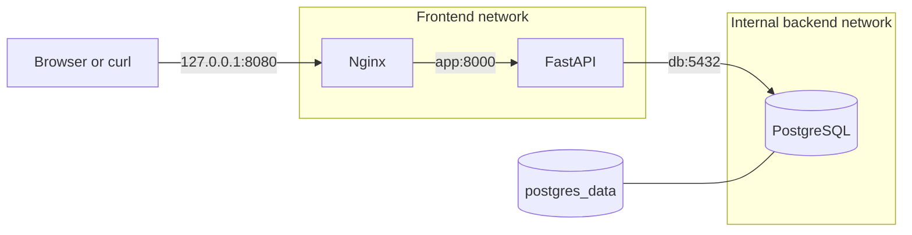

# Production-Style Three-Tier DevOps Platform

A personal portfolio capstone that deploys and operates an **Infrastructure Service Portal** locally. It demonstrates a realistic request path, PostgreSQL persistence, migrations, backup and restore, container security, Ansible automation, CI validation, immutable GHCR images, rollback, and incident troubleshooting. It is educational work rather than employer production experience.

## Architecture



Only Nginx publishes a loopback port. The app uses `expose`, not `ports`. PostgreSQL has no host port and joins only the internal backend network.

## Stack and implemented features

- FastAPI, Pydantic validation, SQLAlchemy and Alembic.
- CRUD endpoints for infrastructure assets plus separate liveness/readiness checks.
- Nginx reverse proxy with forwarded headers and access/error logs.
- PostgreSQL named volume, healthcheck, timestamped backups and confirmed restores.
- Non-root app image, read-only app filesystem, capability dropping and resource limits.
- Bash deployment, health gate, image rollback and 10 isolated troubleshooting labs.
- Ansible role for a disposable Ubuntu lab server.
- PR CI: Ruff, pytest, Compose, Bash, ShellCheck, image build, Trivy and integration smoke.
- Main pipeline: tests and immutable `${GITHUB_SHA}` image publication to GHCR. It never deploys.

## Quick start

Prerequisites: Docker Desktop with WSL2 or Docker Engine, Compose v2, Git, Bash and curl.

```bash
cp .env.example .env
# Change POSTGRES_PASSWORD in .env before first start.
docker compose build
docker compose up -d --wait
docker compose ps
./scripts/health-check.sh
```

Open `http://127.0.0.1:8080/docs`. PostgreSQL and FastAPI are not published to the host.

## API examples

```bash
curl http://127.0.0.1:8080/health/live
curl http://127.0.0.1:8080/health/ready
curl http://127.0.0.1:8080/version

curl -X POST http://127.0.0.1:8080/api/assets \
  -H 'Content-Type: application/json' \
  -d '{"hostname":"edge-01.local","ip_address":"10.20.1.10","environment":"prod","description":"edge proxy"}'

curl http://127.0.0.1:8080/api/assets
curl http://127.0.0.1:8080/api/assets/1
curl -X DELETE http://127.0.0.1:8080/api/assets/1
```

## Everyday Docker operations

```bash
docker compose logs --tail=100 proxy app db
docker compose exec proxy nginx -t
docker compose exec db pg_isready
docker compose down --remove-orphans
```

An **image** is an immutable build artifact; a **container** is a running instance. A named **volume** persists database data; a **bind mount** maps a host file such as `nginx.conf`. `expose` documents an internal port; `ports` publishes it to the host. Build arguments affect image construction; environment variables configure running containers.

## Database backup and restore

```bash
./scripts/db-backup.sh
./scripts/db-restore.sh backups/portal-YYYYMMDDTHHMMSSZ.sql.gz
./scripts/db-verify.sh
```

Restore requires `RESTORE` confirmation unless `--yes` is supplied for a controlled exercise. A gzip check alone proves file integrity, not recoverability; the restore script also verifies the `assets` table.

## Deploy and rollback

```bash
./scripts/deploy.sh three-tier-portal:local
./scripts/deploy.sh ghcr.io/ahmedzaki2206/three-tier-portal:COMMIT_SHA
./scripts/rollback.sh
```

Rollback records an explicitly previous application image. It does not reverse Alembic migrations automatically; database rollback needs a reviewed migration or verified restore plan.

## Ansible disposable VM workflow

Install the collection, update `ansible/inventory/hosts.yml`, provide the database password via Ansible Vault, then run:

```bash
cd ansible
ansible-galaxy collection install -r requirements.yml
ansible-playbook site.yml --syntax-check
ansible-playbook site.yml --ask-vault-pass
ansible-playbook site.yml --ask-vault-pass  # second run should be idempotent
```

Never target the workstation or employer infrastructure. The inventory address is an example for a disposable VM.

## CI/CD and GHCR

CI validates pull requests and does not deploy. On `main`, GitHub Actions logs in to `ghcr.io` with the least-privilege `GITHUB_TOKEN` and publishes `ghcr.io/<owner>/three-tier-portal:<full-git-sha>`. Package visibility may need to be changed to public in GitHub Packages. Manual deployment sets `APP_IMAGE` to that exact immutable tag.

## Troubleshooting lab

```bash
./lab.sh list
./lab.sh start 01
./lab.sh hint 01
./lab.sh status
./lab.sh reset 01
```

See [Hands-on Labs](docs/HANDS_ON_LABS.md) for symptoms, diagnostics, fixes, verification and reset instructions.

## Security and limitations

- `.env` and generated backups are ignored; `.env.example` contains local placeholders only.
- TLS is intentionally absent. A real public service needs trusted HTTPS, secret management and managed access controls.
- The local PostgreSQL user owns the application database. Production would separate migration and runtime privileges.
- Image tags are versioned but base images are not digest-pinned in this learning project.
- Local Compose is single-host and offers no high availability.

## Validation and cleanup

Real results are recorded in [TEST_RESULTS.md](docs/TEST_RESULTS.md).

```bash
pytest
ruff check .
docker compose config --quiet
./scripts/smoke-test.sh
docker compose down --remove-orphans
# Destructive and project-specific, only when you intentionally want to erase data:
docker volume rm three-tier-postgres-data three-tier-nginx-logs
```

## Documentation

- [Step-by-step Egyptian Arabic guide](docs/STEP_BY_STEP_GUIDE.md)
- [Architecture explained](docs/ARCHITECTURE_EXPLAINED.md)
- [Operations runbook](docs/OPERATIONS_RUNBOOK.md)
- [Hands-on labs and final assessment](docs/HANDS_ON_LABS.md)
- [Interview preparation](docs/INTERVIEW_PREPARATION.md)
