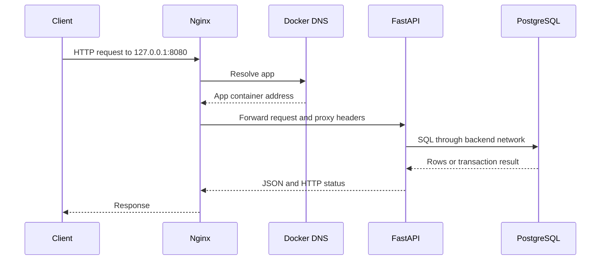
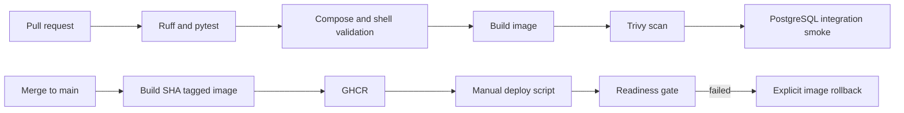

# Architecture Explained — شرح المعمارية

## Components and request lifecycle

`proxy` joins only `frontend`. `app` joins `frontend` and `backend`, so it is the controlled bridge between web and data tiers. `db` joins only the internal `backend` network. Docker DNS resolves service names on shared networks. PostgreSQL never publishes `5432` to Windows.

## Persistence and migrations

`three-tier-postgres-data` survives container replacement. The one-shot `migrate` service waits for PostgreSQL health, runs `alembic upgrade head`, and must finish before the application starts. A container can disappear without deleting the volume. `docker compose down --volumes` deletes project data and therefore belongs only in disposable CI or explicit cleanup.

## Configuration

Compose reads `.env` at runtime. The repository contains only `.env.example`. `DATABASE_URL` is assembled inside Compose and passed to the app and Alembic. Image build dependencies are fixed in `requirements.txt`; runtime values such as password, version and image tag stay outside the image.

## CI/CD lifecycle

CI checks proposed changes. The main workflow performs continuous delivery of an image artifact to GHCR. Deployment remains manual. The deploy script records current and previous image tags, updates services and refuses to report success unless readiness passes.

## Security boundaries and trade-offs

- App runs as a non-root user with a read-only filesystem and no Linux capabilities.
- Nginx binds to port 8080 and receives only the capabilities its official entrypoint needs.
- Database data is private to a named volume and backend network.
- Nginx publishes only on `127.0.0.1`, so another LAN device cannot connect by default.
- Local HTTP is suitable for the lab. Public production traffic requires TLS and trusted certificate lifecycle management.
- Compose environment variables are convenient local configuration, not a production secret manager.

## Rollback distinction

Application rollback selects a known image tag and is usually quick. Schema state is shared by old and new images. An automatic `alembic downgrade` could destroy data or be incompatible, so the runbook requires an explicit migration plan or verified database restore.
